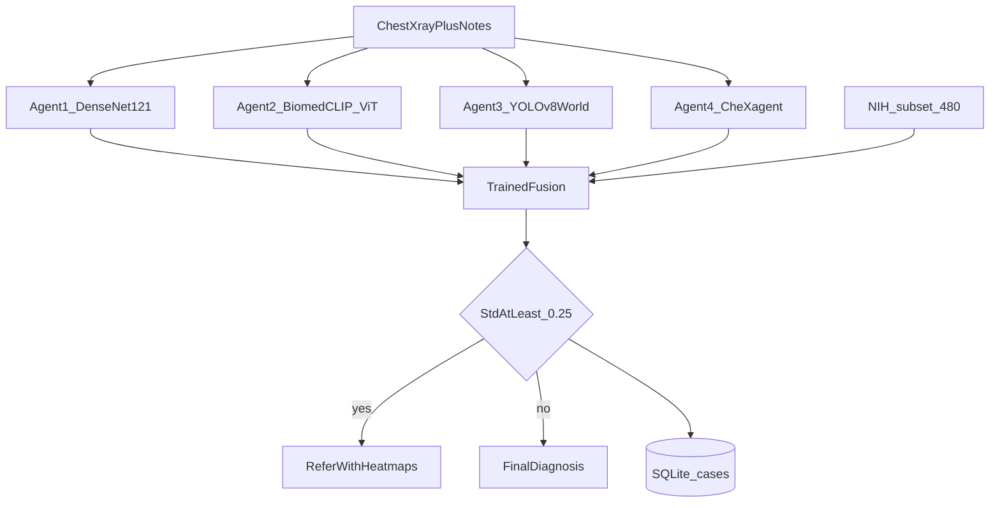
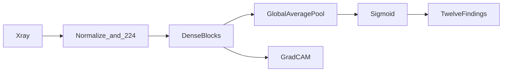
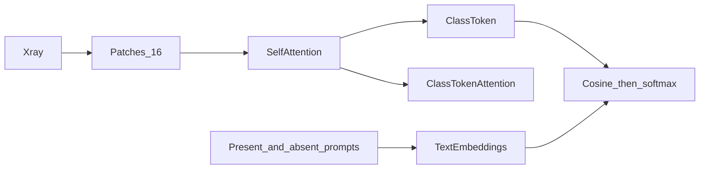
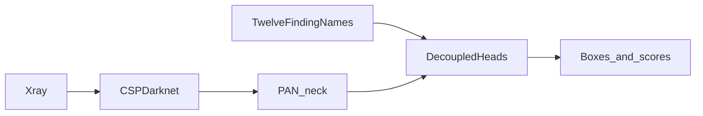
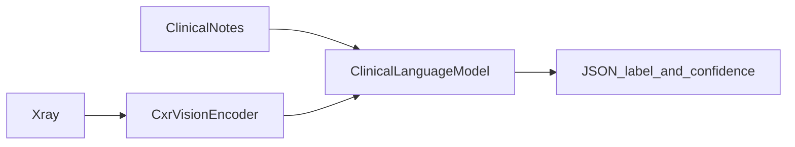
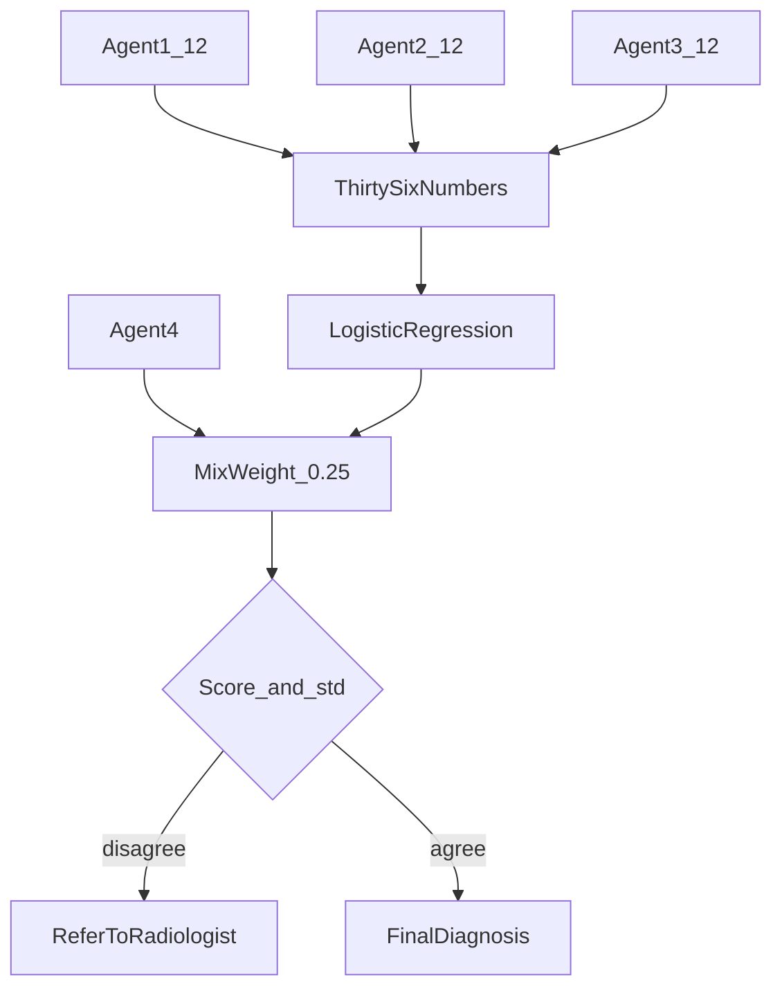

# CXR Review Desk

A local chest X-ray review desk for a college project. Four frozen readers look at one film. A small model trained on a public NIH subset combines three of them. The desk either reports a final diagnosis or refers the study to a radiologist.

This is a research tool. It is not a medical device and it does not replace a reader.

## What is used, and why

| Piece | What | Why it is here |
| --- | --- | --- |
| Python 3.11 virtual environment | `.venv` on each computer | The project can be copied without carrying an installed environment. Another PC creates its own. |
| FastAPI + the pages in `web/` | The review desk UI | A case list, a film viewer, and a saved history read as an application. |
| SQLite `cases.db` | The database | Every study, each agent's scores, the decision, and the training score are stored in one file. No database server. |
| DenseNet-121 | Agent 1, local texture | Dense blocks keep fine grayscale patterns. Weights: `densenet121-res224-all` from torchxrayvision. |
| BiomedCLIP ViT-B/16 | Agent 2, global pattern | Self-attention relates distant parts of the film. No classifier is trained on this agent. |
| YOLOv8-World | Agent 3, localization | Anchor-free boxes from the 12 finding names. No VinBig training step. |
| CheXagent-2-3B | Agent 4, notes | The only reader that sees the typed clinical notes. It runs when an NVIDIA GPU is present. |
| Logistic regression | The trained fusion | Learned on frozen outputs from agents 1–3. This is the training step. The four readers are not retrained. |
| NIH ChestX-ray subset | 400 train and 80 test images | Public Hugging Face set `Sohaibsoussi/NIH-Chest-X-ray-dataset-small`. No account and no API key. |

Nothing calls a paid model API. Weights download from GitHub, Hugging Face, and Ultralytics on first use.

The shared findings are: Atelectasis, Cardiomegaly, Consolidation, Edema, Effusion, Fibrosis, Infiltration, Mass, Nodule, Pleural Thickening, Pneumonia, Pneumothorax.

## Flow

1. You drop in a frontal chest X-ray and, if you have them, clinical notes.
2. Agent 1, Agent 2, and Agent 3 score the 12 findings from the image alone.
3. Agent 4 reads the image and the notes. Without an NVIDIA GPU it is skipped, and the other three still run.
4. The fusion model turns the 36 image-agent scores into one score per finding. Agent 4 is then mixed in at a fixed weight of 0.25, and only for findings it actually named.
5. If any finding with a fused score of at least 0.35 has a vote standard deviation of at least 0.25, the outcome is **Refer to radiologist** and the maps are shown. Otherwise the outcome is **Final diagnosis**: findings at or above 0.50.
6. The study is written to SQLite and shows up in History.

If `checkpoints/fusion.joblib` is missing, step 4 uses confidence weighting instead: `score = sum(confidence × probability) / sum(confidence)`. An abstention has weight 0. The desk still runs.

## Where the dataset sits

The dataset does not retrain DenseNet, BiomedCLIP, YOLO-World, or CheXagent.

`python -m cxr.train_fusion` downloads 480 images into `data/nih_small/`, runs agents 1–3 once, and saves their probabilities in `data/nih_small/features.npz`. A logistic regression per finding is fit on the 400 training images and scored with macro-F1 on the 80 test images. The weight file is `checkpoints/fusion.joblib`. The F1 is stored in the `training_runs` table.

NIH reports are not in this set. Notes in the desk are what you type, and they are stored with the study.

Attribution: NIH Clinical Center, ChestX-ray8, Wang et al., CVPR 2017. https://nihcc.app.box.com/v/ChestXray-NIHCC

## Algorithms

### Agent 1 — local texture

DenseNet-121. Each dense block concatenates the feature maps in front of it, so the decision can use small grayscale patterns. The head is a sigmoid over 18 chest findings; 12 of those are kept. Confidence is that sigmoid probability. The map is Grad-CAM on the last dense block, drawn as an amber overlay.

### Agent 2 — global relationships

ViT-B/16 inside BiomedCLIP. The film is split into 16×16 patches. Self-attention mixes every patch with every other patch, then a class token summarizes the film. For each finding, two sentences are scored: "chest radiograph showing {finding}" and "chest radiograph with no {finding}". Confidence is the softmax probability of the present sentence. The map is the class token's attention onto the image patches in the last transformer block. No head is trained.

### Agent 3 — localized boxes

YOLOv8-World. An anchor-free detector: CSPDarknet backbone, PAN neck, decoupled class and box heads. The class prompts are the 12 finding names. Confidence for a finding is the highest box score, or 0 when no box is found. The map is those boxes drawn on the film.

### Agent 4 — image plus notes

CheXagent-2-3B. A chest X-ray vision encoder is projected into a clinical language model. The prompt includes the notes and demands a JSON list of `{label, confidence}` using only the 12 names. Unknown names are dropped. Findings it does not mention are abstentions, not zeros. This model does not draw a map. Its panel is the written rationale. It stays off when the computer has no NVIDIA GPU.

### Fusion and the gate

Agents 1–3 produce 12 numbers each. Those 36 numbers are the input. During training, each finding gets its own logistic regression on the NIH labels that overlap the list. At review time, Agent 4's probability replaces 25% of that score when Agent 4 voted.

Disagreement is the standard deviation of the agents that voted. Refer when both of these are true for any finding:

- fused score ≥ 0.35
- standard deviation ≥ 0.25

Otherwise report every finding whose fused score is ≥ 0.50.

## Database

`cases.db` is created the first time the desk starts.

- `studies`: time, image path, clinical notes
- `agent_reports`: agent name, status, scores, map path, rationale
- `decisions`: outcome, fused scores, disagreement, findings
- `training_runs`: dataset name, train count, test count, macro-F1

Uploaded films live in `data/uploads/`.

## What is left out

The four readers are not retrained. The full NIH set of 112,120 images is not downloaded. There is no login and no deployment server. YOLO-World boxes are a localization signal for this architecture, not a VinDr-trained detector.
