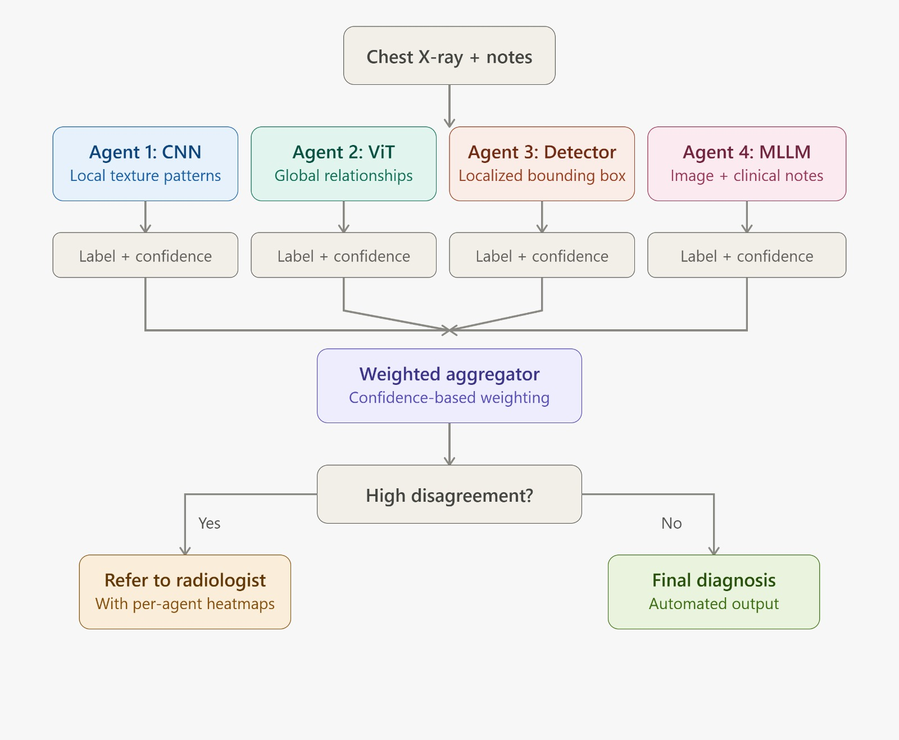
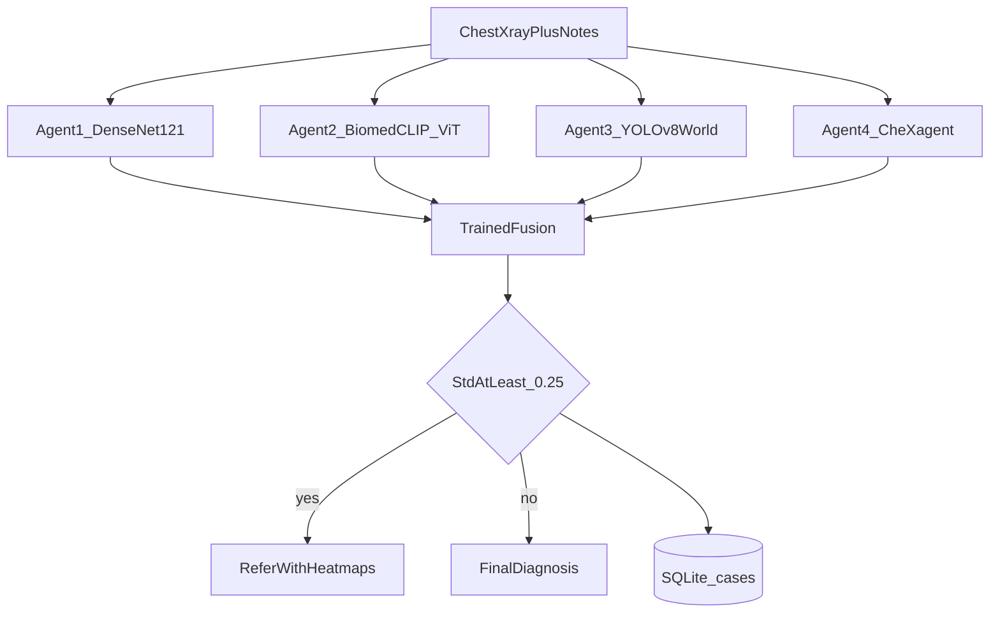

# CXR Review Desk

A local chest X-ray review desk for a college project. Four frozen readers look at one frontal film and optional clinical notes. A small fusion model, trained on a public NIH subset, combines the three image readers. The desk either reports a final diagnosis or refers the study to a radiologist.

Research use only. This is not a medical device and it does not replace a reader.

Nothing calls a paid model API. No account and no API key are required. Weights download from GitHub, Hugging Face, and Ultralytics the first time a reader runs.



## Pages

| Page | Address | What it is for |
| --- | --- | --- |
| New study | `/` | Drop a PNG or JPEG, add notes if you have them, and run the review. |
| History | `/history` | Studies saved on this computer, with each reader's scores and maps. |
| Training record | `/training` | The fusion model's held-out macro-F1 and a score for each finding. |
| How it works | `/about` | A short picture of the four readers and the decision. |

After the server starts, open [http://127.0.0.1:7860](http://127.0.0.1:7860).

## Readers

All four readers stay frozen. Training fits only the fusion model.

| Reader | Model | What it contributes |
| --- | --- | --- |
| Agent 1, local texture | DenseNet-121 (`densenet121-res224-all`, torchxrayvision) | Sigmoid scores for fine grayscale patterns. The map is Grad-CAM on the last dense block. |
| Agent 2, global pattern | BiomedCLIP ViT-B/16 | Zero-shot present versus absent prompts. The map is the class token's attention on the last block. No head is trained. |
| Agent 3, localization | YOLOv8-World | Anchor-free boxes from the 12 finding names. The map is those boxes. |
| Agent 4, notes | CheXagent-2-3B | The only reader that sees the typed notes. It runs when an NVIDIA GPU is present. On a CPU it stays off and the other three still decide. |

The shared findings are Atelectasis, Cardiomegaly, Consolidation, Edema, Effusion, Fibrosis, Infiltration, Mass, Nodule, Pleural Thickening, Pneumonia, and Pneumothorax.

## How a study is decided



1. Agents 1–3 each score the 12 findings from the image. That is 36 numbers.
2. Agent 4 reads the image and the notes. Without an NVIDIA GPU it is skipped.
3. One logistic regression per finding turns the 36 numbers into one score. When Agent 4 named a finding, its probability replaces 25% of that score.
4. If any finding has a fused score of at least 0.35 and a vote standard deviation of at least 0.25, the outcome is **Refer to radiologist**. Otherwise the outcome is **Final diagnosis** for findings at or above 0.50.
5. The study, the four reports, and the decision are written to SQLite.

If `checkpoints/fusion.joblib` is missing, step 3 uses confidence weighting: `score = sum(confidence × probability) / sum(confidence)`. The desk still runs.

Algorithm diagrams for each reader are in [PROJECT.md](PROJECT.md).

## Dataset and training

The dataset does not retrain DenseNet, BiomedCLIP, YOLO-World, or CheXagent.

`python -m cxr.train_fusion` downloads 480 images from the public set `Sohaibsoussi/NIH-Chest-X-ray-dataset-small` into `data/nih_small/` (400 train, 80 test). It runs agents 1–3 once, fits one logistic regression per finding, and writes `checkpoints/fusion.joblib`. The test macro-F1 is stored in SQLite and shown on the Training record page.

Attribution: NIH Clinical Center, ChestX-ray8, Wang et al., CVPR 2017. https://nihcc.app.box.com/v/ChestXray-NIHCC

## Stack

| Piece | Role |
| --- | --- |
| Python 3.11 virtual environment | Each computer creates its own `.venv`. |
| FastAPI and the pages in `web/` | The review desk. |
| SQLite `cases.db` | Studies, agent reports, decisions, and the training score. |
| scikit-learn logistic regression | The trained fusion step. |

## Run it

Python 3.11 and Git are required. Allow about 8 GB of disk for the libraries and the three image models. The notes model adds about 13 GB and downloads only on a machine with an NVIDIA GPU. Full setup, training, and the failure notes are in [STEPS.md](STEPS.md).

```text
git clone https://github.com/Saptesh27/cxr-review-desk.git
cd cxr-review-desk
py -3.11 -m venv .venv
.\.venv\Scripts\activate
python -m pip install --upgrade pip
python -m pip install -r requirements.txt
python -m cxr.train_fusion
```

Windows PowerShell, from the project folder with the virtual environment activated:

```text
$env:PYTHONUTF8 = "1"
$env:PYTHONIOENCODING = "utf-8"
python -m uvicorn cxr.server:app --host 127.0.0.1 --port 7860
```

Or, after the virtual environment exists:

```text
powershell -ExecutionPolicy Bypass -File .\run.ps1
```

The first review downloads model weights and can take several minutes. Training the fusion model can take about an hour on a CPU. You can skip training and still review films. The desk then uses confidence weighting until `checkpoints/fusion.joblib` exists.

`.venv`, `data`, `cases.db`, and `checkpoints` are not in this repository. Each machine creates them.
